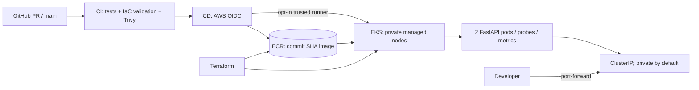

# CloudScope Pulse — AWS DevOps / Platform Engineering Portfolio

**A real, observable FastAPI workload with a live operations dashboard, Docker packaging, Kubernetes/Kustomize manifests, Terraform-managed AWS EKS infrastructure, and GitHub Actions CI/CD.** Designed as a practical portfolio project with a **local-first ($0 AWS)** demo and an **opt-in paid EKS** path.

> **STATUS:** Source code + local tests are provided; cloud resources have **not been provisioned**, GitHub Actions have **not yet been executed**, and no AWS deployment or performance claim is made. See `docs/portfolio.md` for proof collection.

## Where this GitHub copy lives

This project is included under [`cloudscope-pulse/`](https://github.com/gargi0806/cloudscope/tree/main/cloudscope-pulse) inside the existing [`gargi0806/cloudscope`](https://github.com/gargi0806/cloudscope) repository, without altering the original CloudScope AWS auditor.

- In GitHub, browse to `cloudscope-pulse/`. When using commands in this README, first run `cd cloudscope-pulse` from the parent repository root.
- The actual root-level `.github/workflows/cloudscope-pulse-ci.yml` contains the CI workflow for this subproject. The workflows under `cloudscope-pulse/.github/workflows/` are **standalone repository templates** and are not automatically discovered by GitHub in this monorepo layout.
- There is **no active AWS release workflow for this monorepo copy**. Publishing to ECR/EKS requires separate manual configuration, account access and explicit authorization; no AWS cloud resources are created by committing this project.
- For AWS OIDC trust, use the real repository name `gargi0806/cloudscope`, not `gargi0806/cloudscope-pulse` unless you later create a separate repository.

## Architecture



See [full network and CI/CD diagram](docs/architecture.md).

## Repository map

```text
cloudscope-pulse/
├── app/                  # FastAPI service + live HTML operations dashboard
├── tests/                # Five application tests
├── Dockerfile            # Non-root container + health check
├── k8s/
│   ├── base/             # Deployment, Service, ServiceAccount, PDB
│   ├── overlays/local/   # Local kind overlay
│   ├── overlays/eks/     # EKS environment overlay
│   └── optional/         # HPA and HTTPS ALB ingress (manual, not default)
├── terraform/            # VPC, private subnets, EKS, IAM OIDC, ECR, budget, logs
├── .github/workflows/    # CI and opt-in CD
├── scripts/              # Local kind and EKS deployment scripts
└── docs/                 # Architecture, security, cost, runbook and resume evidence
```

## Quick start A — run app without Docker

Requires Python 3.12+.

```bash
python -m venv .venv
# Linux/macOS: source .venv/bin/activate
# Windows PowerShell: .venv\Scripts\Activate.ps1
python -m pip install -r app/requirements-dev.txt
python -m pytest -q tests
uvicorn app.main:app --host 127.0.0.1 --port 8080
```

Visit `http://localhost:8080` for the live dashboard, `/docs` for Swagger, `/metrics` for Prometheus exposition.

## Quick start B — Docker

Requires Docker Desktop / Engine.

```bash
docker build -t cloudscope-pulse:dev .
docker run --rm --name cloudscope -p 8080:8080 -e APP_ENV=docker cloudscope-pulse:dev
```

Visit `http://localhost:8080`. A real Docker run verifies the image; downloading this repo alone does not.

## Quick start C — local Kubernetes (`kind`)

Requires Docker, [kind](https://kind.sigs.k8s.io/) and kubectl. Run from repository root:

```bash
./scripts/local-kind.sh
kubectl -n cloudscope port-forward svc/cloudscope-api 8080:80
```

Windows: run the two commands through WSL2 or Git Bash with the prerequisites installed. Once running, open the operations dashboard on `http://localhost:8080`. Tear down local cluster with `kind delete cluster --name cloudscope`.

## Optional AWS EKS — **paid**; read first

1. Read [cost controls and deletion](docs/cost.md), [security limits](docs/security.md) and [architecture](docs/architecture.md).
2. Use a personal sandbox AWS account, AWS CLI, Terraform, kubectl, and appropriate IAM permissions including IAM, EKS, ECR, EC2, CloudWatch and AWS Budgets. Ensure service quotas and `t3.medium` capacity exist in your chosen region.
3. Get **your own public IP /32**, choose an actual IAM admin principal ARN (not an STS ARN), and use the exact GitHub repo path:

   ```bash
   cd terraform
   cp terraform.tfvars.example terraform.tfvars
   # Edit every example value in terraform.tfvars
   terraform init
   terraform fmt -recursive
   terraform validate
   terraform plan -out=demo.tfplan
   # Read the planned resources AND AWS Pricing Calculator before applying
   terraform apply demo.tfplan
   ```

4. Read outputs: `terraform output ecr_repository_url`, `terraform output github_actions_role_arn`, `terraform output cluster_name`. **AWS begins billing for provisioned services.** Do not casually leave the cluster running.
5. From your trusted admin IAM principal that has cluster access, bootstrap the namespace:

   ```bash
   aws eks update-kubeconfig --name "$(terraform output -raw cluster_name)" --region ap-south-1
   kubectl apply -f ../k8s/base/namespace.yaml
   ```

6. Push the repository to a GitHub `main` branch matching `github_repository` in `terraform.tfvars`. Set GitHub **Actions variables** (not access-key secrets):
   - `AWS_ROLE_ARN`: `terraform output -raw github_actions_role_arn`
   - `AWS_REGION`: your configured AWS region
   - `AWS_ACCOUNT_ID`: your 12-digit account ID
   - `ECR_REPOSITORY`: `cloudscope-pulse` (or Terraform `project`)
   - `EKS_CLUSTER`: `terraform output -raw cluster_name`
   - `ENABLE_DEPLOY`: leave unset/`false` until a **trusted self-hosted** deploy runner exists and reaches the EKS endpoint from its allowed CIDR.
7. `CI` runs on main/PR. `CD` runs only after the **push-to-main CI workflow succeeds**, publishing that same tested commit SHA to ECR with short-lived GitHub OIDC credentials. For automatic EKS deployment, separately register a **trusted self-hosted Linux x64 runner** labeled `cloudscope-deploy`, allow its egress IP in EKS API CIDRs (or place it in VPC private network), protect the `main` branch, and set `ENABLE_DEPLOY=true`. This requires deliberate setup; public GitHub runners cannot necessarily reach the restricted API. **Do not enable a self-hosted runner for untrusted PR code.**
8. Alternatively, from an admin workstation inside your approved API access CIDR, authenticate to AWS, run `AWS_REGION=ap-south-1 ./scripts/push-ecr.sh` from the repo root, copy its published image URI, then deploy with:

   ```bash
   IMAGE="<published ECR URI:40-character-SHA>" \
     EKS_CLUSTER="<terraform cluster_name output>" \
     AWS_REGION="ap-south-1" ./scripts/deploy-eks.sh
   ```

   Replace the bracketed placeholders with actual values. If an ECR tag already exists, do not push the same immutable SHA a second time.
9. Once verified, destroy everything **that you own** with `terraform plan -destroy` then `terraform destroy` from `terraform/`. ECR image deletion and optional ingress resources may need cleanup first. Review the AWS console for remaining billable resources.

### Why optional public ingress is not enabled automatically

Creating an ALB requires an AWS Load Balancer Controller with its own narrowly scoped IAM permission setup, an ACM certificate, DNS, and additional charges. A sample HTTPS ingress is at `k8s/optional/aws-alb-ingress.yaml`; **do not apply unmodified**. AWS controller instructions: https://docs.aws.amazon.com/eks/latest/userguide/lbc-helm.html . This demo intentionally uses private `ClusterIP` plus port-forward until the optional secure ingress is configured.


## Optional: publish this subproject as a separate standalone GitHub repository

Create an empty **private or public** repository named `cloudscope-pulse` on GitHub (do not initialize it with a README), then from the unzipped project directory:

```bash
git init -b main
git add .
git commit -m "Build CloudScope Pulse DevOps portfolio"
git remote add origin https://github.com/YOUR_USERNAME/cloudscope-pulse.git
git push -u origin main
```

Replace `YOUR_USERNAME` with the repository owner. Before using AWS, edit `terraform/terraform.tfvars` so `github_repository` matches **exactly**. Confirm CI is green and fix any external dependency or base-image vulnerability findings; these scans have not been run in this workspace. Never commit Terraform state, `.tfvars` values, AWS credentials, or personal account IDs.

## Built-in protection and telemetry

- JSON logs, request counter, latency histogram, live uptime and deployment metadata.
- Probes, resource requests and limits, 2 replicas, rolling update and PDB.
- Non-root Docker/Kubernetes user, read-only filesystem, dropped capabilities, seccomp, disabled service-account token.
- Private subnets, restricted EKS API CIDR, OIDC exact branch trust, namespace-scoped deploy role.
- CI: tests, dependency audit, Terraform fmt/validate, Docker build and Trivy image scan.
- ECR immutable SHA tags, image lifecycle retention, seven-day EKS logs, budget email **alerts only**.

For truthful scope and remaining production gaps see [security](docs/security.md). For troubleshooting see [runbook](docs/runbook.md). For a paced proof-based implementation see [10-day roadmap](docs/roadmap.md).

## External technical references

- AWS EKS support calendar: https://docs.aws.amazon.com/eks/latest/userguide/kubernetes-versions.html
- AWS EKS pricing: https://aws.amazon.com/eks/pricing/
- AWS private/public subnet guidance: https://docs.aws.amazon.com/eks/latest/best-practices/subnets.html
- AWS EKS access entries: https://docs.aws.amazon.com/eks/latest/userguide/access-entries.html
- GitHub OIDC: https://docs.github.com/en/actions/how-tos/secure-your-work/security-harden-deployments/oidc-in-aws
- AWS Load Balancer Controller: https://docs.aws.amazon.com/eks/latest/userguide/lbc-helm.html

**License:** MIT. Author credit can be added when the repository is published.
