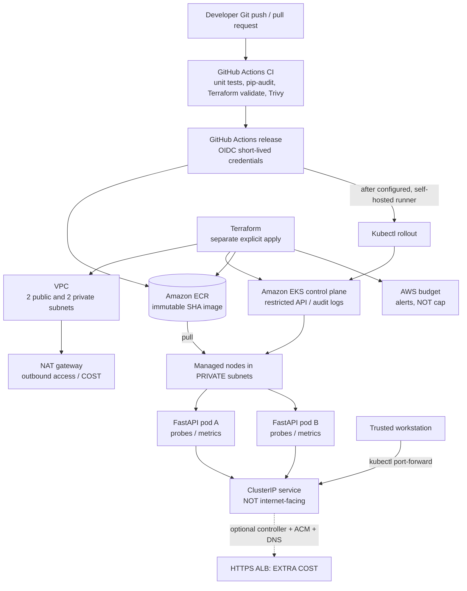

# Architecture and runtime boundaries

## Deliberate decisions

- `kind` provides a **zero-AWS-bill** local development/demo route.
- EKS is genuinely managed Kubernetes; private EC2 workers occupy two private subnets.
- A shared NAT gateway avoids exposing worker nodes but costs money and is a **single-AZ egress failure point**. Production would prefer per-AZ NAT or VPC endpoints as appropriate.
- EKS public API restricted by user-supplied CIDRs and private API also enabled. GitHub-hosted runners do **not** automatically have network access; a self-hosted runner inside a trusted network is optional for deployment.
- The application is `ClusterIP` by default. An optional ALB Ingress file is supplied but is not automatically deployed, since internet ingress, TLS/DNS, and controller IAM need separate setup.
- GitHub OIDC role is constrained to `main`; EKS access entry grants namespace-limited edit privileges, not cluster-admin.
- No database, secrets, or fabricated AWS metrics; this is a stateless operations API.

## Request path

Browser -> local port-forward -> Kubernetes ClusterIP -> one of two pods -> `/api/v1/status` -> JSON.

## Rollout path

Developer main push -> CI checks -> GitHub OIDC -> ECR `:<40-char-commit-sha>` -> optional trusted self-hosted deploy runner -> manifest image substitution -> rollout status.
